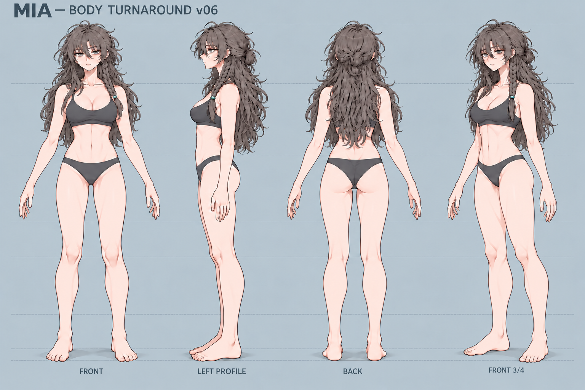

# Mia 참조 이미지 인덱스

원화의 역할과 확인 상태를 함께 표시한다. **사용자가 확인한 디자인**과 **생성된 수정 후보**는 구분하며, 어느 이미지도 그 자체로 3D 형상·UV·리깅의 검수 통과를 뜻하지 않는다.

## 현재 확인된 디자인과 선택 기준

| 역할 | 이미지 | 상태 / 사용 범위 |
|---|---|---|
| 최신 얼굴·원래 헤어 | [재확인 얼굴 원화](references/received/mia-face-reaffirmed-20261031.png) | 사용자 재확인. 눈매·얼굴 인상·웨이브·왼쪽 braid 기준. 숨겨진 두개골 깊이까지 확정하지 않음 |
| 눈매와 속눈썹 구분 | [사용자 색상 표시 비교](references/received/mia-eye-lash-user-markup-20261102.png) | 빨강=원화의 실제 눈매, 초록=속눈썹. 주황/노랑의 기존 모델과 다름을 직접 지적한 관찰 자료. 색상 선을 텍스처로 쓰거나 현재 모델 승인으로 해석하지 않음 |
| 캐릭터·의상·소품 | [v22 착의 마스터](references/mia-clean-master-v22.png) | 기존 승인 디자인. 뷰별 포즈·비율 차이가 있어 엄밀한 정투영 도면은 아님 |
| 표정·선 표현·미묘한 얼굴 시점 | [재확인 표정 시트](references/mia-expression-style-confirmed-20261031.png) | 사용자 확인 역할 유지. 표정뿐 아니라 고개와 시선의 미묘한 각도도 대조 |
| 정면 체형 인상·복부·원래 헤어 | [재확인 전신 정면](references/received/mia-front-body-reaffirmed-20261031.png) | 사용자 재확인. 옷에 가려진 체형의 치수는 미확정 |
| 후속 체형 수정의 정면 기준 | [사용자 선택 정면](references/body-foundation/anchors/mia-body-front-user-selected-20261031.png) | 추가 수정의 기준으로 선택됨. 이후 파생 시트의 자동 승인을 뜻하지 않음 |
| 현재 바디 수정 기준 | [사용자 재첨부 v06 4뷰](references/received/mia-body-v06-confirmed-20261102.png) | **2026-11-02 사용자가 직접 재첨부하며 현재 바디의 목표로 지정.** 가슴의 크기·높이, 흉곽·어깨·머리 비율, 속옷 및 목·쇄골 표현의 기준. 그림의 포즈·투영 불확실성과 실제 모델 검수는 별도 |

### 최신 재확인 얼굴·헤어

### 기존 캐릭터 디자인 마스터

### 표정과 선 표현 기준

## 생성된 수정 후보와 모델링 보조

| 역할 | 이미지 | 상태 / 한계 |
|---|---|---|
| 요청한 국소 정면 수정 | [종아리 v01](references/body-foundation/front-revisions/calf-v01/mia-body-front-calf-v01.png) | 선택 정면에서 파생한 수정 후보. 최종 승인·정확한 감소율은 보증하지 않음 |
| v06의 기존 보관본 | [v06 메인 턴어라운드](references/body-foundation/v06/mia-body-turnaround-v06.png) | 재첨부된 현재 목표와 픽셀 동일. 최초 생성 시 후보였으나 2026-11-02 사용자 지시로 바디 수정의 기준이 됨. 실제 모델 렌더·정확한 치수 도면은 아님 |
| 헤어 가림 해제 보조 | [v06 visibility guide](references/body-foundation/v06/mia-body-visibility-guide-v06.png) | 2026-11-03 사용자가 묶음머리 바디 원화를 직접 지목하며 승모근·어깨 비교 기준으로 재확인. FRONT/PROFILE/BACK/3⁄4의 드러난 목–어깨 윤곽을 사용하되, 포즈·투영 차이를 기록한다. 헤어 디자인 교체나 정확한 치수 도면을 뜻하지 않음 |

v06은 선택 정면과 종아리 수정에서 파생했으며 현재 사용자가 바디 수정 기준으로 지정했다. 이 지정은 3D 모델이나 표정·애니메이션의 검수 통과를 뜻하지 않는다. 사용자가 수용한 현재 얼굴 내부 조형은 보존하고, 전신 머리 비율 변경은 전체 부착물과 함께 별도로 검토한다. 그림에 가려진 형상·투영 추정은 확인된 디자인과 분리해 기록한다.

2026-11-02 추가 보조 원화: [상·하단/팔 전개 8뷰](references/body-foundation/v06/supplements/upper-body-8views-v01.png), [골반을 보정한 E2/F2 하단 2뷰](references/body-foundation/v06/supplements/low-pelvis-E2-F2-v01.png). 내장 imagegen으로 v06에서 파생했다. 원래 E/F의 좁은 골반에 대한 사용자 피드백은 **이 생성 원화에만 해당**하며 모델 골반 수정 지시가 아니다. E2/F2도 원안의 정확한 치수·투영을 대신하지 않는다. 생성 프롬프트의 각도를 실측 카메라 값으로 취급하지 않으며 G/H의 팔은 요청60도보다 수평에 가깝다. 각 파일 옆에 프롬프트와 provenance를 보관한다.

2026-11-03 사용자가 [E2/F2를 다시 첨부](references/received/mia-low-view-axilla-reaffirmed-20261103.png)하며 **둥글고 충만한 유방 볼륨 및 유방 뿌리–겨드랑이–흉곽의 겹침을 비교할 기준**으로 명시했다. 이 상체 검토 역할을 단순 생성 보조라는 이유로 무시하면 안 된다. 기존 E2/F2와 픽셀 동일하며, 재첨부 원본 바이트와 새 역할을 별도 provenance에 저장했다. 전신 비율은 기존 v06을 유지하고, 그림의 숨겨진 구조·카메라 각도는 여전히 추정임을 기록한다. 이 지시가 모델 골반 전체의 확대를 뜻하지는 않는다.

## 보존 자료와 상세 기록

- 기존 보조 원화: [정면 v22](references/mia-canonical-source-v22.png), [16표정 v22](references/mia-expressions-clean-16-v22.png).
- 이전 후보·생성 입력·변경 사유: [참조 관리 안내](references/README.ko.md).
- 역할·확인 상태·파생 관계: [reference-catalog.json](references/reference-catalog.json).
- 이미지 경로·SHA-256·크기: [files.json](references/files.json).
- 최신 얼굴 원화의 바이트 보존 기록: [provenance](references/received/mia-face-reaffirmed-20261031.provenance.json).

기존 후보와 원본은 비교 이력으로 보존한다. 모델 체크포인트와 생성 페인트 밑그림은 이 원화 목록의 승인 디자인으로 올리지 않는다.
