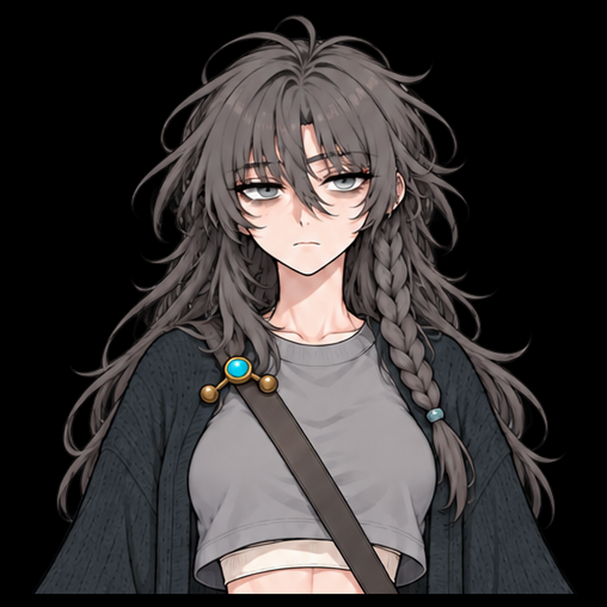
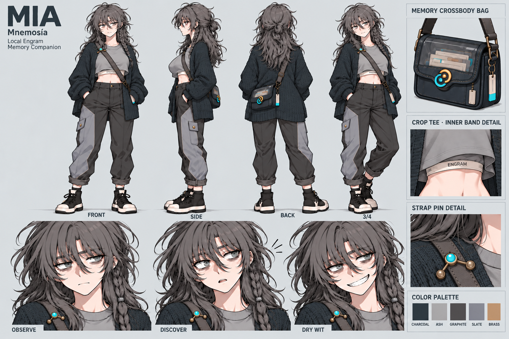
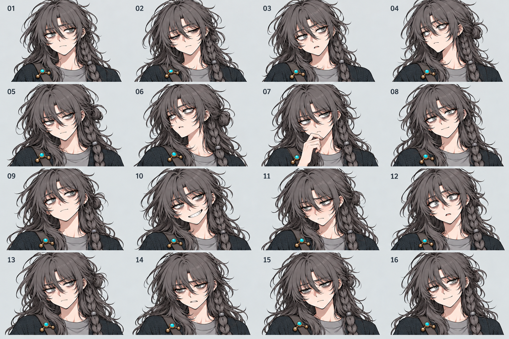
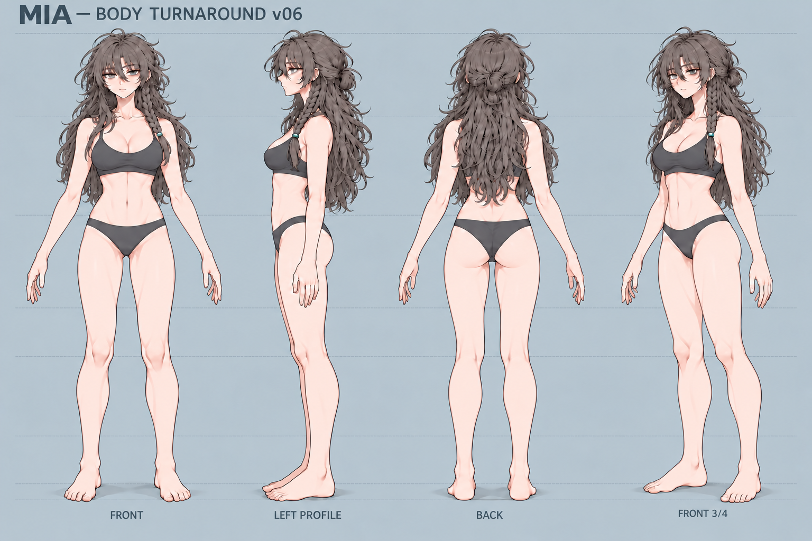

# Mia 참조 이미지 인덱스

원화의 역할과 확인 상태를 함께 표시한다. **사용자가 확인한 디자인**과 **생성된 수정 후보**는 구분하며, 어느 이미지도 그 자체로 3D 형상·UV·리깅의 검수 통과를 뜻하지 않는다.

## 현재 확인된 디자인과 선택 기준

| 역할 | 이미지 | 상태 / 사용 범위 |
|---|---|---|
| 최신 얼굴·원래 헤어 | [재확인 얼굴 원화](references/received/mia-face-reaffirmed-20261031.png) | 사용자 재확인. 눈매·얼굴 인상·웨이브·왼쪽 braid 기준. 숨겨진 두개골 깊이까지 확정하지 않음 |
| 눈매와 속눈썹 구분 | [사용자 색상 표시 비교](references/received/mia-eye-lash-user-markup-20261102.png) | 빨강=원화의 실제 눈매, 초록=속눈썹. 주황/노랑의 기존 모델과 다름을 직접 지적한 관찰 자료. 색상 선을 텍스처로 쓰거나 현재 모델 승인으로 해석하지 않음 |
| 캐릭터·의상·소품 | [v22 착의 마스터](references/mia-clean-master-v22.png) | 기존 승인 디자인. 뷰별 포즈·비율 차이가 있어 엄밀한 정투영 도면은 아님 |
| 표정·선 표현·미묘한 얼굴 시점 | [재확인 표정 시트](references/mia-expression-style-confirmed-20261031.png) | 사용자 확인 역할 유지. 표정뿐 아니라 고개와 시선의 미묘한 각도도 대조 |
| 정면 체형 인상·복부·원래 헤어 | [재확인 전신 정면](references/received/mia-front-body-reaffirmed-20261031.png) | 사용자 재확인. 옷에 가려진 체형의 치수는 미확정 |
| 후속 체형 수정의 정면 기준 | [사용자 선택 정면](references/body-foundation/anchors/mia-body-front-user-selected-20261031.png) | 추가 수정의 기준으로 선택됨. 이후 파생 시트의 자동 승인을 뜻하지 않음 |

### 최신 재확인 얼굴·헤어

### 기존 캐릭터 디자인 마스터

### 표정과 선 표현 기준

## 생성된 수정 후보와 모델링 보조

| 역할 | 이미지 | 상태 / 한계 |
|---|---|---|
| 요청한 국소 정면 수정 | [종아리 v01](references/body-foundation/front-revisions/calf-v01/mia-body-front-calf-v01.png) | 선택 정면에서 파생한 수정 후보. 최종 승인·정확한 감소율은 보증하지 않음 |
| 최신 사용 가능한 4뷰 체형 시트 | [v06 메인 턴어라운드](references/body-foundation/v06/mia-body-turnaround-v06.png) | **사용자 검토 전 생성 후보**. 승인된 체형 치수나 실제 모델 렌더가 아님 |
| 헤어 가림 해제 보조 | [v06 visibility guide](references/body-foundation/v06/mia-body-visibility-guide-v06.png) | 목·어깨·등을 검토하기 위한 보조 후보. 헤어 디자인을 교체하지 않음 |

v06은 선택 정면과 종아리 수정에서 파생한 후보이며, 별도 v04 측면 볼륨 요청의 완료를 뜻하지 않는다. 상부 3/4의 두상 깊이와 눈–볼 연결은 추가 검토가 필요하다. 기준 이미지에 없는 형태를 추정한 경우 승인 사실과 분리해 기록한다.

## 보존 자료와 상세 기록

- 기존 보조 원화: [정면 v22](references/mia-canonical-source-v22.png), [16표정 v22](references/mia-expressions-clean-16-v22.png).
- 이전 후보·생성 입력·변경 사유: [참조 관리 안내](references/README.ko.md).
- 역할·확인 상태·파생 관계: [reference-catalog.json](references/reference-catalog.json).
- 이미지 경로·SHA-256·크기: [files.json](references/files.json).
- 최신 얼굴 원화의 바이트 보존 기록: [provenance](references/received/mia-face-reaffirmed-20261031.provenance.json).

기존 후보와 원본은 비교 이력으로 보존한다. 모델 체크포인트와 생성 페인트 밑그림은 이 원화 목록의 승인 디자인으로 올리지 않는다.
