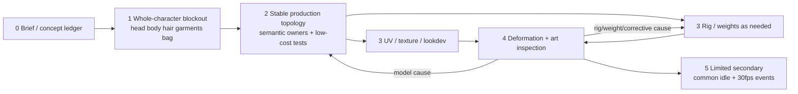

# Mia 애니메이션용 전문 제작 절차 — 계획과 수용 조건

상태: **PLANNED / 모델·UV·베이크·rig·animation gate는 모두 NOT RUN**. 목표는 원화에서 출발해 애니메이션·30fps sprite 출력까지 갈 수 있는 반복 제작 절차를 정하는 것이다. Pixal은 원화 닮음이 좋았던 **비교/재사용 후보**이지 base, 신규 생성 기법, donor workflow로 확정되지 않았다.

## 우선 원화와 후보 ledger

최우선 원화는 `asset/mia/references/mia-clean-master-v22.png` (`3c760f1c276f343258ac38c6abbe370a511b9a148f4ffa37a08f8a277fa05d19`) 및 `mia-expression-style-confirmed-20261031.png` (`bb42eb0eb54bef2c571424c18c59cdda552184a65ed3e5ebd58c6a8708fb1f52`)다. 두 시트는 strict orthographic turnaround가 아니며 포즈·카메라 차이가 있다.

[inventory.json](inventory.json)은 Pixal GLB 후보의 path/SHA/구조를 보존한다. 후보는 모두 **UNDECIDED**다. 구조 수치만으로 semantic part, 연속 메시, 사용 가능 topology를 결론 내리지 않으며 v30 A-pose/crop 및 multiview camera 가설도 원화 해석 보조일 뿐이다. 이 milestone에서는 생성 재실행을 하지 않는다.

## 근거와 접근 수준

| 근거 | 실제 확인 범위 | Mia에 쓰는 범위 |
|---|---|---|
| Blender Studio [Artist Guide — Modeling](https://studio.blender.org/tools/artist-guide/asset-creation/modeling) | 공개 검색 인덱스 본문 확인, 직접 open은 402. approved design, concept sculpt/deformation test/style guide handoff, loose model→retopo, topology/UV seam 상호 영향, production modeling 단계의 full UV. 개인 저자 미표기/WIP 2023. | blockout·deformation test·retopo/UV handoff의 순서 근거. |
| Blender Studio [Rigging](https://studio.blender.org/tools/pipeline-overview/rigging) | 공개 검색 인덱스 본문 확인, 직접 open은 402. Demeter Dzadik: control rig→manual weights→correctives; bones/correctives 기본, physics 필수 아님. | weights/correctives와 한정 secondary 구분. |
| Blender Studio [Animation Testing](https://studio.blender.org/tools/pipeline-overview/asset-creation/animation-testing) | 공개 검색 인덱스 본문 확인, 직접 open은 402. initial rig + approved design/expression/hero pose→stress→rig/model feedback 반복→guides/pose library→walk/more tests. | early test와 production stress feedback 반복 gate. |
| Blender Studio [Asset Pipeline](https://studio.blender.org/tools/addons/asset_pipeline) | 공개 검색 인덱스 본문 확인, 직접 open은 402. model/rig/shading task layer와 data ownership. | part owner/handoff 정의; 개별 atlas 강제 아님. |
| Dillon Gu [Toon Character Workflow](https://studio.blender.org/training/toon-character-workflow/) | 공개 검색 인덱스 목차 확인, 직접 open은 402; 유료 본편 미시청. concept→modeling(Shape Keys Mouth 포함)→rigging/weights/face/scarf→shading→walk cycle. | toon 생산 절차 사례일 뿐 Mia 품질 보증 근거 아님. |
| [Neogools 조사](../research/neogools/README.ko.md) | 원화 image plane/guide UV, 측면 부피의 실제 ASR·화면 표본 범위만. | direct-poly와 원화 대조의 구체 기법 근거이며 전체 전문 pipeline 근거로 과장하지 않음. |

## 6단계 반복 제작 흐름

| 단계 | 목적과 산출물 | 시작/종료 gate | 상태 |
|---|---|---|---|
| 0. 제작 brief | 원화 핵심, 허용 표정/pose/camera, 30fps sprite 출력, part/UV 책임과 후보 ledger | 원화 SHA·후보 path/SHA 기록 → 시각 비교 계획 | PLANNED |
| 1. 전체 blockout·디자인 정합 | 머리·몸·헤어·의상·가방 큰 실루엣을 함께 대조하고 guide color를 일찍 쓴다. 전신 비율 정합 뒤 얼굴/체형, 헤어, 의상/소품 detail 순으로 진행한다. | Stage 0 → near/far 정·측·후·양 3/4의 clay/wire/actual-color 검토 | NOT RUN |
| 2. production modeling/topology | 허용된 원본을 비교 재료로만 쓰며 부위별 direct-poly/retopo를 선택한다. semantic surface, 눈·입 관절 loop, 두께·틈, hero pose와 간단 변형 시험. | Stage 1 → part owner/retopo와 trial rig 진입 | NOT RUN |
| 3. 안정 topology handoff | 안정 topology 뒤 UV/texturing/lookdev와 rig/weights를 필요에 따라 병행하고 placeholder color를 유지한다. | Stage 2 → part별 UV/bake/lookdev와 rig 변경 범위 기록 | NOT RUN |
| 4. rig stress·animation test | on-model pose library, 허용 표정/hero pose, 대표 clip으로 rig/model/weight/corrective feedback을 반복. | Stage 3 → stress 실패를 owner 단계로 반환, 동일 뷰에서 수정 전후 확인 | NOT RUN |
| 5. 한정 secondary·sprite | 필요한 hair/cloth만 collision proxy/cache로 정리하고 common idle, loop/transition, 30fps event sprite. | Stage 4 → pre-roll/cache/bake 재현, loop seam/clip transition/30fps 확인 | NOT RUN |

Stage 1의 **초기 owner 계획**과 실제 제작 순서를 혼동하지 않는다. 큰 실루엣 정합 뒤 실제 부품 검수는 face/body volume → hair volume·attachment·front/rear/half-up/braid → garment layers → bag/accessories 순이다. 각 항목 검수 뒤 Stage 2의 part별 retopo/trial rig로 간다. 고정 폭포수가 아니며 실패 시 원인을 소유한 단계로 돌아가 같은 camera/view에서 수정 전후를 다시 본다.

위 병렬 표기는 안정 topology 이후 UV/lookdev와 rig/weights가 필요에 따라 겹칠 수 있음을 뜻한다. UV 이전 full rig를 절대 규칙으로 만들지 않으며, 이벤트 작업은 common idle·loop·transition 검수에 의존한다.

## Data ownership과 분리 판단

| Owner | 원칙 |
|---|---|
| head, eyes, lashes | 표정·gaze 기준이며 hair 교체와 독립. head/body는 owner 구분일 뿐 목 object 분리를 강제하지 않고 연속 메시도 가능. |
| scalp, front/rear/half-up/braid hair | 모근/attachment와 replaceable mass를 구분; hair mass가 얼굴 부피를 대신하지 않음. |
| crop, inner band, cardigan, pants | layer, 두께, 틈과 deformation 책임을 부위별로 정함. |
| bag, strap, hardware | rigid/parent·접촉 책임을 명시. strap은 collision proxy 후보이나 physics 자동 의무화 아님. |

공유 atlas는 허용한다. atlas 공유나 Blender Loose Parts 자동 분리가 semantic surface·deformation owner를 증명하지 않는다.

## 변형·lookdev·sprite 수용 조건

저비용 early test로 blink/gaze/jaw, head rotation, arm/torso, sit, step, hero pose를 확인해 재작업을 줄인다. 이는 “UV 전에 full rig가 업계 절대 규칙”이라는 주장이 아니다. 안정 topology handoff 뒤 production rig stress와 model/weight/corrective feedback을 수행한다. 모든 shape 검수는 **near/far × 정/측/후/양 3/4 × clay/wire/actual color**를 남긴다.

최종 bake/lookdev는 원본 albedo 색을 우선하고 기존 PBR의 고정 광원/AO 음영을 무조건 겹치지 않는다. toon shader/normal, 다크서클, 눈테 작화 합성이 volume 결손·clip·topology 오류를 가려 PASS시키면 안 된다. Blender [Render Baking](https://docs.blender.org/manual/id/5.2/render/cycles/baking.html)의 target UV/active image, Selected-to-Active, custom cage 조건에서 유도해 part별 source 선택·mask·cage·pass를 기록하여 hair→face bleed를 막는다.

Surface Deform은 [개발 문서](https://docs.blender.org/manual/en/dev/modeling/modifiers/deform/surface_deform.html)상 proxy deformation이며 큰 surface 불일치 artifact가 있고 충돌 해결기가 아니다. 5.4 development 문서이므로 5.2 Mia 사용은 아직 미시험이다. Cloth cache [소개](https://docs.staging.blender.org/manual/en/latest/physics/cloth/introduction.html)·[설정](https://docs.staging.blender.org/manual/en/latest/physics/cloth/settings/cache.html)의 cache invalidation, preview/render subdivision, 선행 frame 주의에 따라 필요한 부위만 secondary를 쓰고 pre-roll/cache/bake를 재현 가능하게 기록한다. Blender sprite 렌더와 Unity/VRM runtime spring은 별개다.

## 기존 연구의 보존

`mia-reference-modeling-v01`/`v02`는 미승인 진단 연구로 보존한다. 기존 42 keys/UV/body 원본은 보존 대상이고 새 topology에 자동 이식한다고 가정하지 않는다. 모든 기존 원화·헤어·Pixal·연구는 폐기물이 아니라 후보 재료다. 이 문서는 무조건 전부 새로 만들거나 추가 모델 변형을 실행하라는 지시가 아니다.
