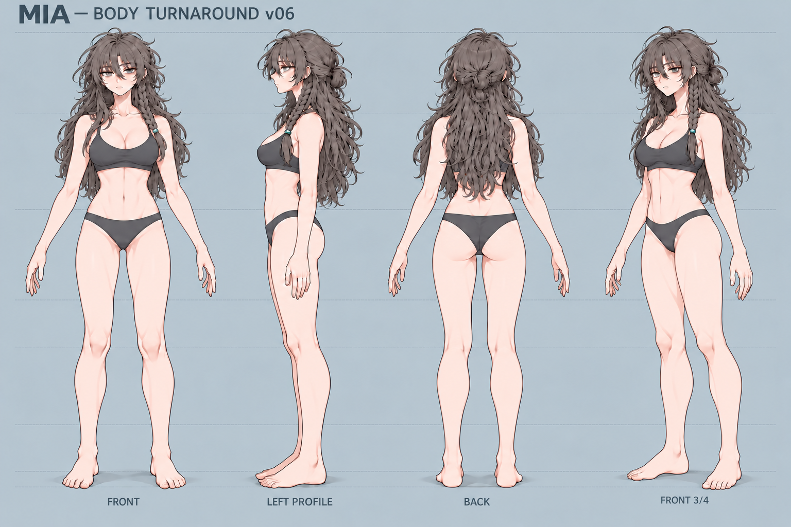
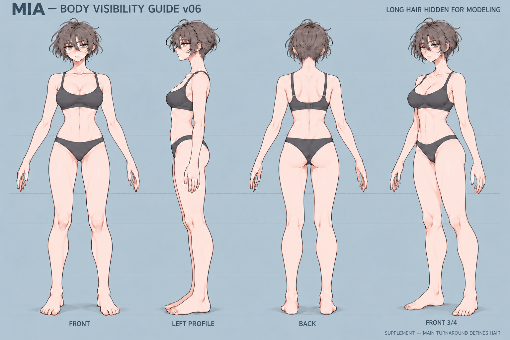
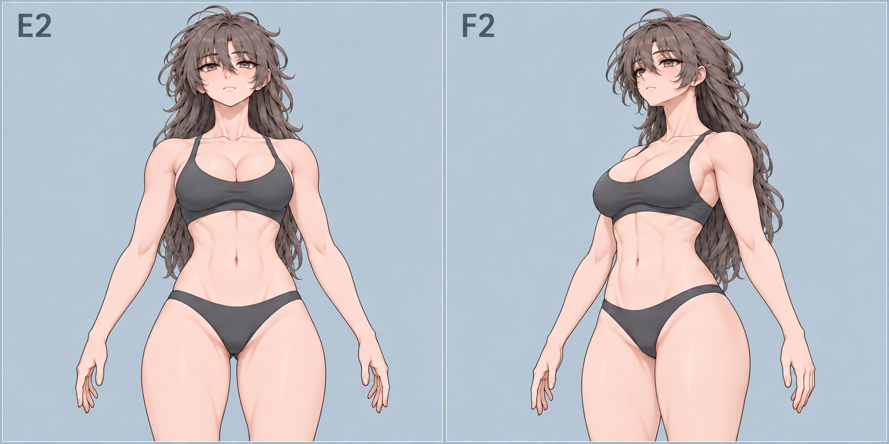
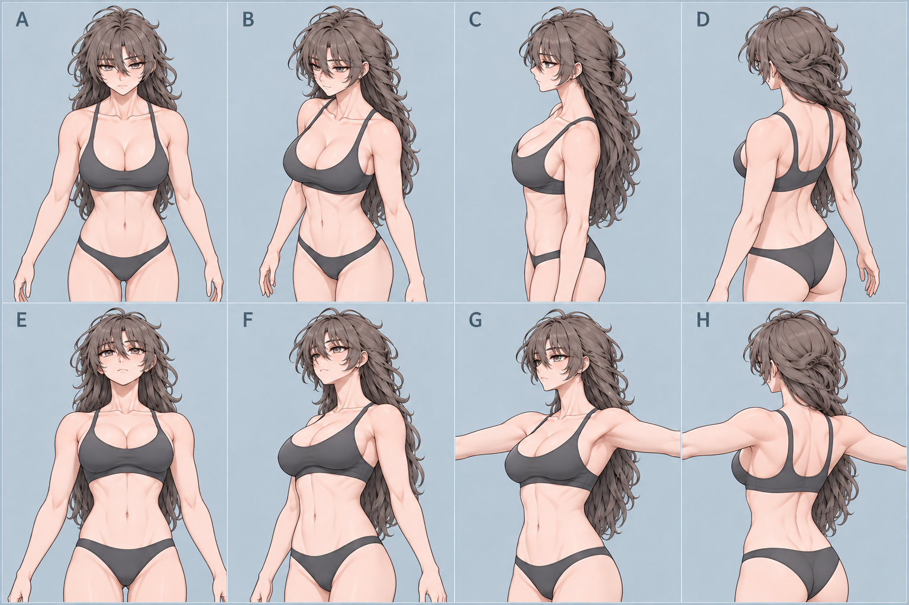

# Mia 바디 원화

[전체 원화](../README.ko.md) · [컨셉](../concept/README.md) · [표정](../expressions/README.md)

## 현재 전신 기준: v06

[재첨부 원본](../received/mia-body-v06-confirmed-20261102.png) · [보관된 v06 원본](v06/mia-body-turnaround-v06.png). 두 파일은 픽셀이 동일하지만 재첨부 provenance를 보존한다. 정면·좌측면·후면·사선의 속옷 핏과 본체 비율을 함께 비교한다. 사용자 지정 디자인 기준이며 3D 검수 통과나 정확한 치수 도면은 아니다.

## 어깨·목·등 가림 해제: 묶음머리 v06

[원본 열기](v06/mia-body-visibility-guide-v06.png). 2026-11-03 사용자가 승모근·어깨 기준으로 재확인했다. 이 자료의 머리 모양은 가림 해제용이며 최종 헤어 교체안이 아니다.

## 하단 사선·겨드랑이 겹침: E2/F2

[재첨부 원본](../received/mia-low-view-axilla-reaffirmed-20261103.png) · [생성 보관본](v06/supplements/low-pelvis-E2-F2-v01.png). 둥근 속옷 지지 볼륨과 유방 뿌리–겨드랑이–흉곽의 연결 기준이다. 생성 시점의 보조안 상태와 이후 사용자 재확인 역할을 구분한다.

## 상·하단과 팔 전개 보조

[원본 열기](v06/supplements/upper-body-8views-v01.png). 원래 E/F의 좁은 골반은 사용자에게 지적되었고 E2/F2로 보완되었다. G/H의 팔 자세도 프롬프트 각도와 정확히 일치하지 않는다. 프롬프트 수치를 실측 카메라/포즈 값으로 사용하지 않는다.

## 선택 정면과 이전안

| 구분 | 자료 | 상태 |
|---|---|---|
| 선택 정면 | [원안 파생 정면](anchors/mia-body-front-user-selected-20261031.png) | 후속 편집의 원점 |
| 국소 수정 | [종아리 수정안](front-revisions/calf-v01/mia-body-front-calf-v01.png) | 생성 수정 후보; v06 파생 이력 |
| v05 | [4뷰](v05/mia-body-turnaround-v05.png) / [가림 해제](v05/mia-body-visibility-guide-v05.png) | v06 이전안 |
| v03 | [4뷰](v03/mia-body-underwear-study-v03.png) / [당시 정면](v03/mia-body-front-refined-study-v03.png) | 후속 선택 정면과 동기화되지 않은 이전안 |
| v02 | [4뷰](v02/mia-body-underwear-study-v02.png) | 체형·헤어 해석 차이로 대체됨 |
| v01 | [4뷰](v01/mia-body-underwear-study-v01.png) | 최초 시안, 현재 기준 아님 |
| v04 | [생성 상태](v04/generation-status.json) | 생성이 완료되지 않아 이미지 없음 |

v01–v03의 `views/`는 기존 시트의 리사이즈 없는 개별 crop이다. 현재 v06과 혼용하지 않는다. 원본·프롬프트·provenance는 각 버전 폴더에 있으며 [전수 파일 목록](../INVENTORY.md)에서 모두 찾을 수 있다.
