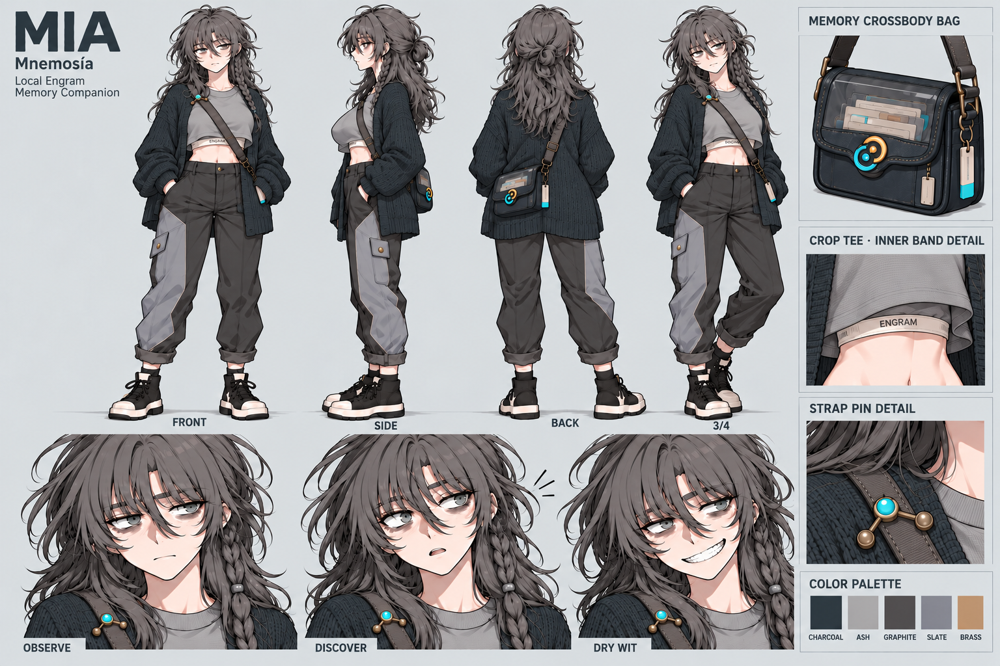
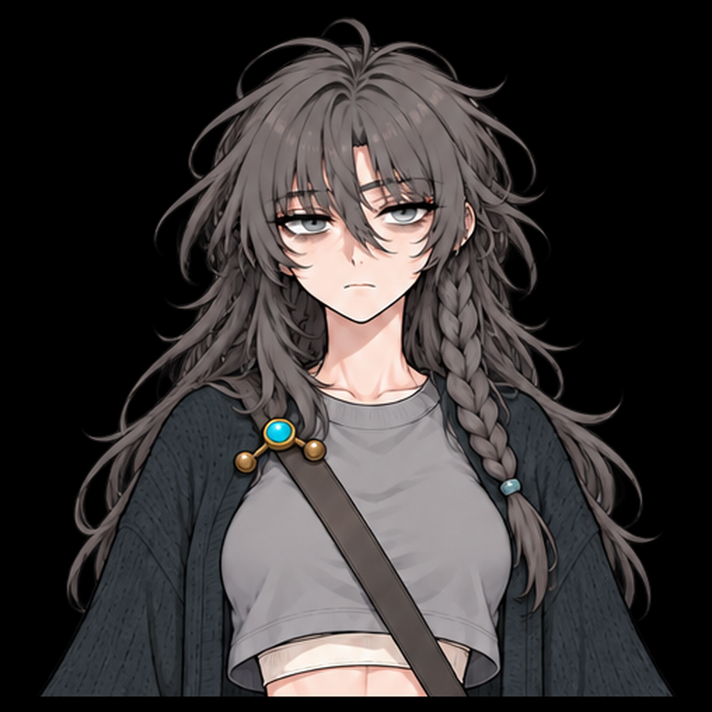
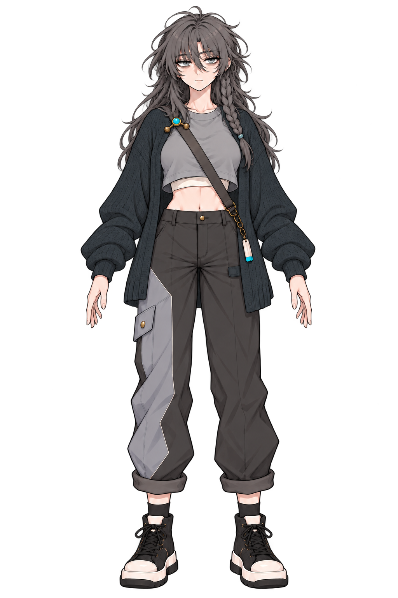

# Mia 컨셉 원화

[전체 원화](../README.ko.md) · [표정](../expressions/README.md) · [바디](../body-foundation/README.md)

## 캐릭터·의상·소품 마스터

[원본 열기](../mia-clean-master-v22.png). 정면·측면·후면·사선, 크로스백, 크롭탑/inner band, 핀과 색상표를 포함한다. 원화의 포즈·투영 차이는 실제 모델 비교에서 구분한다.

## 사용자 재확인 얼굴·원래 헤어

[원본 열기](../received/mia-face-reaffirmed-20261031.png). 지친 인상, 메이크업, 앞머리, 웨이브·브레이드의 기준이다. 눈썹·눈매는 [표정 시트](../expressions/README.md)와 함께 확인한다.

## 재확인 전신 정면

[원본 열기](../received/mia-front-body-reaffirmed-20261031.png). 착의 실루엣과 호리호리한 복부 인상 기준이다. 옷에 가린 본체 비율은 [바디 v06](../body-foundation/README.md)을 함께 본다.

## 보존된 이전 보조 원화

[정면 v22](../mia-canonical-source-v22.png). 재첨부 전신과 바이트가 다르므로 덮어쓰지 않고 이력으로 보존한다.

원본 이미지의 기존 경로는 Blender 스크립트·provenance 연결을 보존하기 위해 유지했다. 이 폴더는 분류별 보기이며 이미지 복제본을 만들지 않는다.
