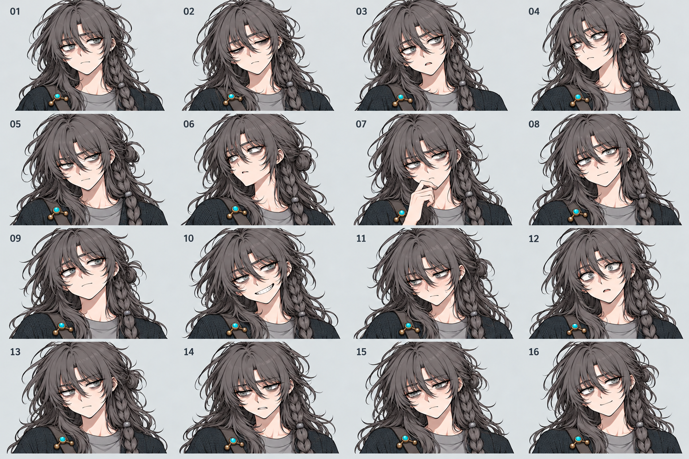
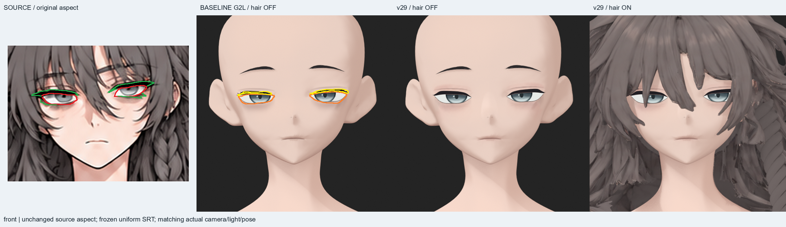

# Mia 얼굴·표정 원화

[전체 원화](../README.ko.md) · [컨셉](../concept/README.md) · [바디](../body-foundation/README.md)

## 사용자 재확인 16표정

[원본 열기](../mia-expression-style-confirmed-20261031.png). 표정뿐 아니라 미묘한 yaw/pitch/roll, 눈꺼풀 개구, 시선, 눈썹·메이크업·다크서클·입꼬리의 대조 기준이다. 각 패널은 동일 카메라의 정확한 정투영으로 간주하지 않는다.

## 실제 눈매와 속눈썹의 구분

[원본 열기](../received/mia-eye-lash-user-markup-20261102.png). 빨강은 실제 눈매, 초록은 속눈썹이다. 주황·노랑은 당시 모델의 비교선이며 목표 윤곽이 아니다. 이 파일에는 이전 모델 렌더가 포함되어 있으므로 순수 디자인 원화와 구분한다.

## 함께 볼 자료

- [재확인 얼굴·헤어 확대 원화](../received/mia-face-reaffirmed-20261031.png)
- [이전 16표정 v22](../mia-expressions-clean-16-v22.png) — 현재 재확인 시트와 다른 파일, 보존용 보조 기준.
- [컨셉 마스터의 표정·색상표](../mia-clean-master-v22.png)

안구 개구/눈꺼풀, 속눈썹 메시, 눈썹, 쌍꺼풀·화장 텍스처를 같은 선으로 취급하지 않는다. 표정별 실제 리깅 검수 완료 여부는 원화가 아니라 CURRENT_STATE의 증거를 따른다.
